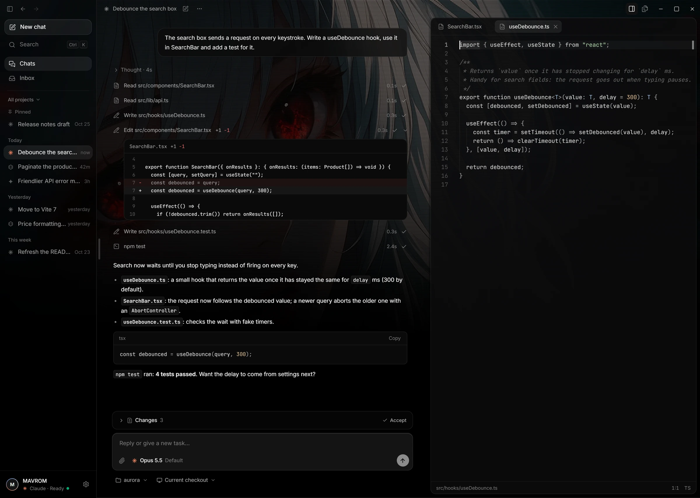
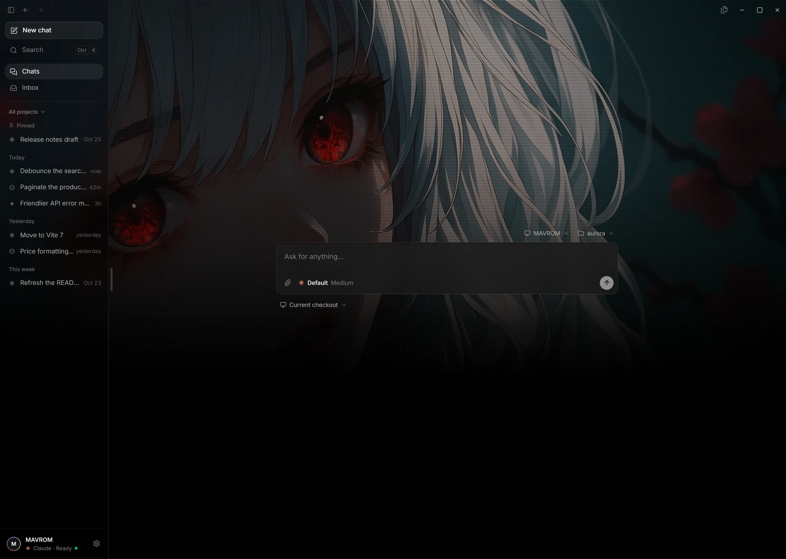

<div align="center">


# Xora Code

**An open-source, agent-first code editor. Bring your own Claude, ChatGPT or Gemini subscription.**

[](https://github.com/Mavrom/xora-code/releases/latest)
[](LICENSE)


[**Download for Windows**](https://github.com/Mavrom/xora-code/releases/latest) · [Features](#features) · [Shortcuts](#keyboard-shortcuts) · [Build from source](#build-from-source)

<br />



</div>

## Why Xora

Most AI editors are a code editor with a chat bolted on. Xora turns that around: **the conversation with your agent is the center of the window**, and the file tree, editor and terminal slide in when you need them.

- **Your subscription, not ours.** Xora drives the official agent CLIs (Claude Code, Codex, Gemini CLI) over the [Agent Client Protocol](https://agentclientprotocol.com/). You sign in through each CLI's own login. Xora has no AI billing of its own, asks for no API keys, and never sees your credentials.
- **You stay in control.** Edits and commands ask first, with a diff. Every file a turn touched can be accepted or reverted. Agents can only reach the folder you opened.
- **Light and quiet.** A native Tauri app with a small footprint, an onyx/AMOLED look, a see-through window if you want it, and no telemetry.

## Features

### Agents

|                              |                                                                                                                                                                            |
| ---------------------------- | -------------------------------------------------------------------------------------------------------------------------------------------------------------------------- |
| **Three agents, one window** | Claude Code, Codex and Gemini CLI, with streaming replies, thinking, tool-call cards, plans and slash commands. Stop a turn with `Esc`, or queue follow-ups while it runs. |
| **Model, mode, effort**      | Pickers filled from what each agent reports. Hide the models you never use.                                                                                                |
| **Hand-off**                 | Continue a conversation with another agent: a new chat opens with what happened so far, ready to send.                                                                     |
| **Worktrees**                | Run a chat in its own git worktree on an `xora/<name>` branch, then merge its work into your branch or throw it away.                                                      |
| **Review**                   | Permission prompts with a diff preview, a changes bar listing every file a turn touched, accept or revert per file.                                                        |
| **Attachments**              | Drop in files, folders and screenshots, paste images, or type `@` to attach a file of the project. Pictures the agent creates show up in the chat.                         |
| **Attention**                | When Xora is in the background, its taskbar button flashes as soon as an agent finishes or needs approval.                                                                 |

### Editor and workspace

|                     |                                                                                                                                                                                           |
| ------------------- | ----------------------------------------------------------------------------------------------------------------------------------------------------------------------------------------- |
| **Editor**          | Monaco, bundled offline, lazy-loaded on the first file. Tabs, format on save, auto save, sticky scroll, bracket colors. `Ctrl+L` sends the selection to the chat with its file and lines. |
| **Files**           | A drawer that slides out from the sidebar's edge, or pinned open. Several folders side by side as tabs, live refresh, full keyboard navigation.                                           |
| **Go to file**      | `Ctrl+P`: fuzzy search over every file in the project, respecting `.gitignore`.                                                                                                           |
| **Terminal**        | Integrated terminal tabs: PowerShell 7, Windows PowerShell, Command Prompt or Git Bash.                                                                                                   |
| **Command palette** | `Ctrl+K` for every command, recent chats and folders.                                                                                                                                     |
| **Inbox**           | Quick-capture notes for ideas that should not derail the current task; send one to the chat with `G`.                                                                                     |

### Look and feel



|                        |                                                                                                                     |
| ---------------------- | ------------------------------------------------------------------------------------------------------------------- |
| **Wallpaper**          | A picture behind new chats, redrawn with a dither, ASCII, halftone or scanline effect, or your own image.           |
| **See-through window** | Frosted (Windows Acrylic), clear or solid, with a darkness slider.                                                  |
| **Settings**           | Searchable, with a reset next to anything changed from its default. Interface scale with `Ctrl +` / `Ctrl -`.       |
| **Languages**          | English and Turkish.                                                                                                |
| **Conversations**      | Grouped by day and project, pinned, renamed, archived, exported as Markdown, reopened with the agent's own history. |

## Getting started

1. **Download** the installer from the [latest release](https://github.com/Mavrom/xora-code/releases/latest) (`.exe` setup or `.msi`) and run it. The installer is not code-signed yet, so Windows SmartScreen may warn: choose _More info → Run anyway_.
2. **Install [Node.js](https://nodejs.org/) 22 or newer.** The agent adapters run on it; Xora installs the pinned adapter versions itself on first use.
3. **Open a folder and pick an agent.** Xora sets the agent up and opens its sign-in the first time.

| Agent       | Status                                                                                                                           |
| ----------- | -------------------------------------------------------------------------------------------------------------------------------- |
| Claude Code | Works end to end with a Claude subscription.                                                                                     |
| Codex       | Installs, starts and reaches ChatGPT sign-in; not yet verified end to end.                                                       |
| Gemini CLI  | Connects, but Google has retired personal Google sign-in for Gemini CLI, so a Gemini subscription cannot be used this way today. |

Windows is the first target. The code is written to stay cross-platform; macOS and Linux builds are on the roadmap.

## Keyboard shortcuts

`Cmd` works in place of `Ctrl` on macOS.

| Shortcut                       | Action                         |
| ------------------------------ | ------------------------------ |
| `Ctrl+K` / `Ctrl+Shift+P`      | Command palette                |
| `Ctrl+P`                       | Go to a file                   |
| `Ctrl+N`                       | New chat                       |
| `Ctrl+L` (editor)              | Send the selection to the chat |
| `Esc` (chat)                   | Stop the running turn          |
| `Ctrl+B`                       | Show or hide the sidebar       |
| `Ctrl+Shift+E`                 | Pin or unpin the files drawer  |
| `Ctrl+Shift+H`                 | Conversations                  |
| `Ctrl+Shift+N`                 | New Inbox note                 |
| ``Ctrl+` ``                    | Toggle the terminal            |
| `Ctrl+S` / `Ctrl+W`            | Save / close the active tab    |
| `Ctrl+,`                       | Settings                       |
| `Ctrl +` / `Ctrl -` / `Ctrl 0` | Interface scale                |

Every command and its shortcut is also listed in Settings > Shortcuts.

## Build from source

You need [Node.js](https://nodejs.org/) 24+, [Rust](https://www.rust-lang.org/tools/install) (stable) and the [Tauri prerequisites](https://v2.tauri.app/start/prerequisites/) for your OS (on Windows: Microsoft C++ Build Tools and WebView2).

```bash
git clone https://github.com/Mavrom/xora-code.git
cd xora-code
npm install
npm run tauri dev
```

The first run compiles the Rust core and takes a few minutes. `npm run tauri build` makes the installers.

No Visual Studio Build Tools? `npm run tauri dev` switches to the LLVM-MinGW toolchain when it is installed: `rustup toolchain install stable-x86_64-pc-windows-gnullvm`, then unpack a `*-ucrt-x86_64.zip` from [llvm-mingw releases](https://github.com/mstorsjo/llvm-mingw/releases) to `%LOCALAPPDATA%\xora-toolchain` (or set `XORA_LLVM_MINGW`).

| Command               | What it does                                          |
| --------------------- | ----------------------------------------------------- |
| `npm run tauri dev`   | Run the app with hot reload                           |
| `npm run tauri build` | Build the installers                                  |
| `npm run check`       | Typecheck, lint, format check and tests (the CI gate) |
| `npm test`            | Frontend tests (Vitest)                               |

### Tech stack

[Tauri 2](https://v2.tauri.app/) (Rust core, system WebView) · React 19 · TypeScript · Vite · Tailwind CSS v4 · Zustand · Monaco · xterm.js · Agent Client Protocol

Read [docs/architecture.md](docs/architecture.md) for the process model, folder map and data flows.

## Roadmap

- macOS and Linux builds
- Signed installers and in-app update notices
- Editable keyboard shortcuts
- More interface languages

## Contributing

Issues and pull requests are welcome. Start with [CONTRIBUTING.md](CONTRIBUTING.md) for setup, quality checks and conventions.

## License

[MIT](LICENSE) © 2026 Xora Code contributors
