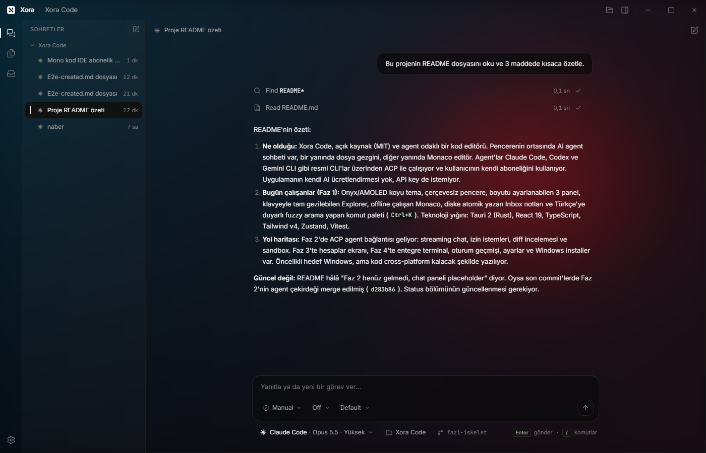

# Xora Code

[English](README.md) · **Türkçe**

Açık kaynak, agent-first bir kod editörü. Kendi Claude, ChatGPT veya Gemini aboneliğini getir.



Xora Code, pencerenin merkezine bir AI agent sohbetini koyar. Sohbetlerin solda durur, dosya gezgini ve editör gerektiğinde açılır, kendi duvar kağıdın cam panellerin arkasından görünebilir. Agent'lar zaten kullandığın CLI'ların (Claude Code, Codex, Gemini CLI) resmi adapter'ları üzerinden, kendi aboneliğinle giriş yapılarak çalışır. Xora Code'un kendi AI faturası yoktur ve API key istemez.

> **Durum:** Faz 1 ve 2 hazır: editör temeli, ACP üzerinden çalışan agent sohbeti, ayarlar ve hesaplar, entegre terminal. Windows'ta Claude Code ile uçtan uca doğrulandı; Codex ve Gemini aynı yolu kullanıyor ama bu hesaplarla tam bir deneme henüz yapılmadı. İlk hedef Windows; kod çapraz platform kalacak şekilde yazılıyor. Arayüz metinleri Türkçe.

## Özellikler

Bugün çalışanlar:

| Alan          | Ne sunuyor                                                                                                                                                                                                                  |
| ------------- | --------------------------------------------------------------------------------------------------------------------------------------------------------------------------------------------------------------------------- |
| Agent sohbeti | Claude Code, Codex ve Gemini CLI, [Agent Client Protocol](https://agentclientprotocol.com/) üzerinden. Akan cevaplar, düşünme blokları, araç kartları, planlar, slash komutları, durdurma.                                  |
| Model ve mod  | Model, mod ve effort seçicileri her agent'ın bildirdiklerinden dolar (Gemini ACP'de effort sunmadığı için orada gizlenir).                                                                                                  |
| İzinler       | Agent'ın düzenlemeleri ve komutları önce izin ister, diff önizlemesiyle. Değişiklikler çubuğu turda dokunulan dosyaları listeler; her biri kabul edilebilir ya da geri alınabilir.                                          |
| Sandbox       | Agent'ın dosya ve terminal erişimi açık klasörle sınırlı (symlink, `..` ve junction'lar kontrolden önce çözülür).                                                                                                           |
| Sohbetler     | Kenar çubuğunda projeye göre gruplu sohbetler; agent'ın kendi geçmişiyle yeniden açılır (`session/load` / `resume`), geçmişi olmayan agent'lar için yerel indeks.                                                           |
| Ayarlar       | Hesaplar (her CLI'ı algılar, giriş durumu, giriş yap / kur), agent varsayılanları, editör, genel, kısayollar, hakkında. `Ctrl+,`.                                                                                           |
| Görünüm       | Onyx / AMOLED siyahı, özel çerçevesiz başlık çubuğu. İsteğe bağlı duvar kağıdı; cam, bulanıklık ve karartma ayarlanabilir.                                                                                                  |
| Terminal      | Sohbet ve editörün altında PowerShell / kabuk sekmeleri (``Ctrl+` ``).                                                                                                                                                      |
| Yerleşim      | Sohbet önce: editör bir dosya açılana kadar kapalı kalır. Boyutu ayarlanabilir paneller, boyutlar oturumlar arasında hatırlanır.                                                                                            |
| Activity bar  | Kenar çubuğunu **Sohbetler**, **Gezgin** ve **Inbox** arasında değiştirir; ayarlar en altta. Inbox simgesi açık not sayısını rozetle gösterir.                                                                              |
| Gezgin        | Sanallaştırılmış klasör ağacı; dosya izleyiciyle canlı yenilenir, son açılan klasörler listelenir, açılışta son klasör geri gelir. Tam klavye gezintisi: roving tabindex, ok tuşları, Home/End, type-ahead.                 |
| Editör        | Monaco, yerel olarak paketlenmiş (çevrimdışı çalışır) ve yalnızca ilk dosya açıldığında lazy-load edilir. Özel `xora-onyx` teması, sekmeler, kaydedilmemiş değişiklik (dirty) takibi, kaydetme ve kapatma kısayolları.      |
| Inbox         | Hızlı not alma: ekleme, yerinde düzenleme, sabitleme, tamamlandı işaretleme, geri alınabilir silme. Rust `notes` modülü ile diske atomik olarak yazılır; debounce'lu kayıt, otomatik yeniden deneme ve kapanışta son flush. |
| Komut paleti  | `Ctrl+K` veya `Ctrl+Shift+P`. Türkçe karakterleri tanıyan fuzzy arama (`klasor ac`, `Klasör aç`'ı bulur), gruplanmış komutlar, kısayol ipuçları.                                                                            |

## Klavye kısayolları

macOS'ta palet, kaydetme, sekme kapatma ve geri alma için `Ctrl` yerine `Cmd` de çalışır.

### Genel

| Kısayol                   | İşlem                                  |
| ------------------------- | -------------------------------------- |
| `Ctrl+K` / `Ctrl+Shift+P` | Komut paletini aç/kapat                |
| `Ctrl+Shift+H`            | Sohbetleri göster                      |
| `Ctrl+Shift+E`            | Gezgin'i göster                        |
| `Ctrl+Shift+N`            | Inbox'ı göster ve not kutusuna odaklan |
| `Ctrl+S`                  | Aktif dosyayı kaydet                   |
| `Ctrl+W`                  | Aktif sekmeyi kapat                    |
| `Ctrl+,`                  | Ayarları aç/kapat                      |
| ``Ctrl+` ``               | Terminali aç/kapat                     |

### Komut paleti

| Kısayol   | İşlem                 |
| --------- | --------------------- |
| `↑` / `↓` | Seçimi taşı           |
| `Enter`   | Seçili öğeyi çalıştır |
| `Esc`     | Paleti kapat          |

### Explorer

| Kısayol           | İşlem                                                |
| ----------------- | ---------------------------------------------------- |
| `↑` / `↓`         | Önceki / sonraki öğe                                 |
| `→`               | Klasörü aç veya ilk alt öğesine geç                  |
| `←`               | Klasörü kapat veya üst klasöre geç                   |
| `Home` / `End`    | İlk / son öğe                                        |
| `Enter` / `Space` | Dosyayı aç veya klasörü aç/kapat                     |
| Harfler           | Type-ahead: bu harflerle başlayan sonraki öğeye atla |

### Editör sekmeleri

| Kısayol        | İşlem                  |
| -------------- | ---------------------- |
| `←` / `→`      | Önceki / sonraki sekme |
| `Home` / `End` | İlk / son sekme        |
| `Delete`       | Odaktaki sekmeyi kapat |

### Inbox

| Kısayol         | Nerede                 | İşlem                        |
| --------------- | ---------------------- | ---------------------------- |
| `Enter`         | Not kutusu             | Notu ekle                    |
| `Shift+Enter`   | Not kutusu / düzenleme | Yeni satır                   |
| `Esc`           | Not kutusu             | Not kutusundan çık           |
| `↑` / `↓`       | Not listesi            | Önceki / sonraki not         |
| `Enter`         | Odaktaki not           | Yerinde düzenle              |
| `P`             | Odaktaki not           | Sabitle / sabitlemeyi kaldır |
| `E`             | Odaktaki not           | Tamamlandı / yeniden aç      |
| `Delete`        | Odaktaki not           | Sil                          |
| `Ctrl+Z`        | Inbox paneli           | Son silmeyi geri al          |
| `Enter` / `Esc` | Yerinde düzenleme      | Kaydet / vazgeç              |

## Yol haritası

Temel fikir **kendi aboneliğini getir**: Xora Code resmi agent CLI'larıyla [Agent Client Protocol (ACP)](https://agentclientprotocol.com/) üzerinden konuşur ve giriş her CLI'ın kendi login akışıyla yapılır. API key desteği şimdilik kapsam dışı.

| Faz      | Kapsam                                                                                                                                                     |
| -------- | ---------------------------------------------------------------------------------------------------------------------------------------------------------- |
| 1        | **Tamamlandı.** Editör temeli: yerleşim, tema, Gezgin, Monaco, Inbox, komut paleti.                                                                        |
| 2        | **Tamamlandı.** Kendi aboneliğinle ACP agent bağlantısı: akan sohbet, izinler, diff incelemesi ve geri alma, sandbox, dosya izleyici.                      |
| 3        | **Tamamlandı.** Ayarlar ve hesaplar, duvar kağıdı ve cam görünüm, entegre terminal, sohbet geçmişi.                                                        |
| Sıradaki | Codex ve Gemini ile tam deneme, Windows kurulum paketi, Claude adapter'ı için isteğe bağlı yönetilen Node.js, sabitlenmiş adapter güncelleme bildirimleri. |

## Teknoloji

| Katman   | Seçim                                                             |
| -------- | ----------------------------------------------------------------- |
| Kabuk    | [Tauri 2](https://v2.tauri.app/) (Rust çekirdek, sistem WebView)  |
| Arayüz   | React 19, TypeScript, Vite                                        |
| Stil     | Tailwind CSS v4, design token'lar `src/styles/globals.css` içinde |
| State    | Zustand                                                           |
| Editör   | Monaco (`monaco-editor` + `@monaco-editor/react`)                 |
| Yerleşim | `react-resizable-panels`                                          |
| İkonlar  | Lucide                                                            |
| Test     | Vitest (frontend), `cargo test` (Rust)                            |

## Başlarken

### Önkoşullar

- [Node.js](https://nodejs.org/) 24 veya üzeri (agent adapter'ları çalışırken Node.js 22+ ister; Xora sabitlenmiş adapter sürümlerini ilk kullanımda kendisi kurar)
- [Rust](https://www.rust-lang.org/tools/install) (stable toolchain)
- İşletim sistemin için Tauri önkoşulları (Windows'ta Microsoft C++ Build Tools ve WebView2): [v2.tauri.app/start/prerequisites](https://v2.tauri.app/start/prerequisites/)

### Çalıştırma

```bash
npm install
npm run tauri dev
```

İlk çalıştırma Rust çekirdeğini derler ve birkaç dakika sürer; sonrakiler artımlıdır.

### Script'ler

| Komut                 | Ne yapar                                                |
| --------------------- | ------------------------------------------------------- |
| `npm run tauri dev`   | Masaüstü uygulamasını hot reload ile çalıştırır         |
| `npm run tauri build` | Release paketi üretir                                   |
| `npm run check`       | Typecheck, lint, format kontrolü ve testler (CI kapısı) |
| `npm test`            | Vitest test paketini çalıştırır                         |
| `npm run lint`        | ESLint'i çalıştırır                                     |
| `npm run format`      | Depoyu Prettier ile formatlar                           |
| `npm run typecheck`   | TypeScript derleyicisini çıktı üretmeden çalıştırır     |

Rust kontrolleri `src-tauri/Cargo.toml` üzerinden çalışır; bkz. [CONTRIBUTING.md](CONTRIBUTING.md).

## Proje yapısı

```
src/
  app/          Uygulama kabuğu: yerleşim, başlık çubuğu, activity bar, UI store
  features/     Her özellik için bir klasör (agents, chat, commands, editor, files, inbox, settings, terminal, workspace)
  shared/       Ortak kod: lib/ (typed IPC, path yardımcıları), ui/ (temel bileşenler)
  styles/       globals.css: design token'lar ve temel stiller
src-tauri/
  src/          Rust çekirdek: agents/ (ACP), accounts/, fs/, notes/, settings/, terminal/ (her modül: mod.rs + commands.rs)
docs/           Mimari notları ve tasarım spec'i
```

Süreç modeli, tam klasör haritası ve veri akışları için [docs/architecture.md](docs/architecture.md) dosyasına bak.

## Katkı

Katkılara açığız. Kurulum, kalite kapıları ve konvansiyonlar için [CONTRIBUTING.md](CONTRIBUTING.md) ile başla.

## Lisans

[MIT](LICENSE) © 2026 Xora Code contributors
